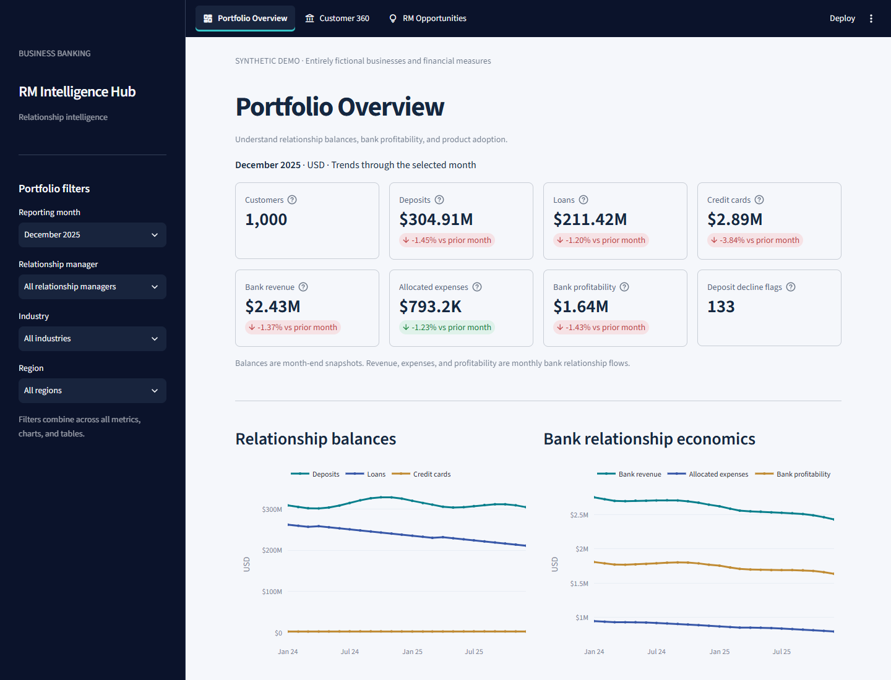

# Business Banking RM Intelligence Hub

A local Streamlit dashboard for exploring fictional business banking relationships.
It combines a standalone data generator, DuckDB analytics, Pandas, and Plotly.

**Synthetic data only:** every business, RM, identifier, financial observation,
and rule parameter is fictional. No real customer data, internal banking datasets,
public economic datasets, or confidential business rules are included or fetched.
No API keys or external accounts are required to run the app.



*Actual app screenshot: the default synthetic portfolio for December 2025.*

## Business context and value

Business banking supports companies with deposits, financing, payments, payroll,
and cash management. A relationship manager (RM) coordinates customer
relationships, understands business needs, and works with credit and product
specialists.

This hub helps an RM review portfolio performance, prepare for customer meetings,
and identify relationships for further investigation. Portfolio Overview shows
the broader picture, Customer 360 explains individual relationships, and RM
Opportunities provides an explainable follow-up worklist.

Potential benefits include more consistent portfolio reviews and better-informed
customer conversations. Revenue growth, retention improvement, and time savings
have not been measured. Deposit-decline and cross-sell signals are prompts for
review; they do not establish customer intent, suitability, or credit approval.

Read [Business context and value](docs/business_context.md) for the banking
economics, RM responsibilities, financial definitions, and fictional workflows.

## The three pages

### Portfolio Overview

Monitor the selected portfolio using reporting-month, RM, industry, and region
filters. The page provides:

- Customer count and closing deposit, loan, and credit-card balances.
- Monthly bank revenue, allocated expenses, and relationship profitability.
- Month-over-month changes and sustained deposit-decline indicator counts.
- Balance and bank economics trends through the selected month.
- Deposit concentration by industry and RM, product penetration, and
  expandable concentration and customer-level tables.

Balances are monthly snapshots; they are not summed across months. Revenue,
expenses, and profitability are monthly flows.

### Customer 360

Search fictional businesses by name or customer ID and select a reporting month.
Review the business profile and RM, financial snapshots and history, product
holdings and changes, and explainable retention/cross-sell signals. Customer
operating sales, expenses, and profit are displayed separately from the bank's
relationship profitability. Historical views exclude later observations and
product changes.

### RM Opportunities

Filter by reporting month, RM, industry, region, signal type, and product.
Review separate signal and unique-customer counts, RM/product distributions,
and an explanation for every worklist row. Retention appears before cross-sell
by default; this is a review order, not a predictive risk score. Percentage and
USD thresholds are labeled separately.

The sidebar and top navigation use midnight navy (#0B132B), with light text
and teal highlights. The dashboard retains a light background for readable charts.
Sidebar colors are configured in .streamlit/config.toml; scoped navigation CSS
is kept in streamlit_app/components.py and should be reviewed after Streamlit upgrades.

Page links appear across the top on desktop. On phone-width screens, use the
top-left chevron to open the responsive page menu. Filters remain in the sidebar.

## Quickstart after cloning

### Prerequisites

- Git, or a downloaded and extracted GitHub source ZIP.
- Python **3.13**. This project currently supports 3.13, not 3.14.
- Internet access for the initial dependency installation.
- uv **0.12.24**, installed below, matching the CI tool version.

Run commands from the **project root**, the directory containing pyproject.toml.
No manual virtual-environment activation is needed: uv creates and uses .venv.

Once the repository is published, clone it using:

```sh
git clone https://github.com/nandinikawale/business-banking-rm-intelligence-hub.git
cd business-banking-rm-intelligence-hub
python -m pip install uv==0.12.24
python -m uv sync --locked --group app
python -m uv run --locked --group app streamlit run streamlit_app/app.py
```

On macOS/Linux, replace python with your Python 3.13 command, such as python3.13,
if python is unavailable or selects another version.

Open the local URL printed by Streamlit, normally http://localhost:8501.
Press **Ctrl+C** in the terminal to stop the server.

**Ready-to-run synthetic data is included.** A fresh clone contains the seven
default CSVs under data/synthetic/. Generation is optional: install dependencies
and launch the app directly. Opening the app never generates or downloads data.

For optional validation or regeneration, see [data instructions](data/README.md).
Regeneration overwrites the included CSVs and writes local reports.

For Code -> Download ZIP, extract the archive, open a terminal in the extracted
folder containing pyproject.toml, and follow the commands starting at pip install.

### Windows / VS Code interpreter troubleshooting

If the terminal selects .venv Python and reports **No module named uv**, invoke
uv through your main Python 3.13 installation. With the Windows Python launcher:

```powershell
py -3.13 -m pip install uv==0.12.24
py -3.13 -m uv sync --locked --group app
py -3.13 -m uv run --locked --group app streamlit run streamlit_app/app.py
```

If py is unavailable, use the full path to your main Python executable.
After installation, you can launch directly from the existing project environment:

```powershell
& '.\.venv\Scripts\python.exe' -m streamlit run streamlit_app/app.py
```

On macOS/Linux, the equivalent is:

```sh
.venv/bin/python -m streamlit run streamlit_app/app.py
```

## Default dataset and reproducibility

| Setting | Default |
| --- | --- |
| Fictional customers | 1,000 |
| Fictional relationship managers | 20 |
| History | January 2024 through December 2025, inclusive |
| Random seed | 42, applied to NumPy and Faker |
| Currency | USD |
| Monthly records | 24,000 in each of the five monthly CSVs |
| Profile records | 1,000 customers and 20 RMs |

Generation uses fixed dates, seeded local random generators, stable row ordering,
and explicit CSV formatting. uv.lock fixes Python dependencies. Repeating
generation with unchanged code, inputs, and the same locked environment recreates
the CSV bytes; the manifest records SHA-256 hashes. Exact byte equality across
different platforms/Python patches is not guaranteed because numerical results
can vary. Use the manifest to check.

Money is rounded to cents; annual rates are decimal fractions; monthly dates
use first-of-month ISO labels. Deposits influence deposit revenue, loans influence
lending revenue, and bank revenue minus allocated expenses reconciles to
relationship profitability. Synthetic histories include growth, seasonality,
distress, and sustained deposit outflows.

See [data generation instructions](data/README.md),
[CSV definitions](docs/data_dictionary.md), and
[simulation assumptions](docs/simulation_assumptions.md).

## Project structure

```text
business-banking-rm-intelligence-hub/
├── pyproject.toml              # Dependencies, packages, generator CLI
├── uv.lock                     # Committed dependency lockfile
├── .python-version             # Python 3.13
├── .streamlit/config.toml      # Theme and local app configuration
├── src/
│   ├── banking_data/           # Standalone generation and validation
│   └── rm_hub/                 # DuckDB repository and business services
├── streamlit_app/
│   ├── app.py                  # Three-page top navigation
│   ├── components.py           # Formatting and reusable Plotly charts
│   ├── data.py                 # Cached service adapters
│   └── views/                  # Portfolio, Customer 360, Opportunities
├── data/
│   ├── README.md               # Generation, regeneration, and schemas
│   └── synthetic/              # Seven default synthetic CSVs, included in Git
├── reports/                    # Generated manifest and validation report
├── docs/                       # Architecture, assumptions, publication guide
├── scripts/                    # Read-only analytics and source packaging
├── tests/                      # Generation, analytics, and Streamlit tests
└── .github/workflows/ci.yml     # Automated checks after upload
```

Data generation, analytics, and presentation are separate. Production application
code never imports simulation scenario assignments. Read
[architecture.md](docs/architecture.md) for queries, connection lifecycle,
caching, metric meanings, and page responsibilities.

## Development checks

After installing the app environment:

```sh
python -m uv run --locked --group app pytest
python -m uv run --locked --group app ruff check .
python -m uv run --locked --group app ruff format --check .
```

Tests use temporary synthetic fixtures; they do not modify the default CSVs.
For formatting changes, run ruff format . instead of the format check.
The GitHub workflow installs locked dependencies, runs code checks, generates
and validates the default dataset, runs the full suite, and exercises analytics.

The read-only terminal demonstration is:

```sh
python -m uv run --locked --group app python scripts/inspect_analytics.py
```

## Common issues

| Issue | Action |
| --- | --- |
| Missing CSVs | Run generation from the project root before launching. |
| No module named uv | Use main Python, py -3.13, or the uv CLI; see Windows instructions above. |
| Unsupported Python | Install/use Python 3.13 and rerun locked synchronization. |
| Port 8501 is occupied | Append --server.port 8502 to the Streamlit launch command. |
| A CSV is locked | Close it in Excel, stop active app queries, and regenerate. |
| Regenerated data is not shown | Restart Streamlit. Results are cached using file metadata. |
| Streamlit suggests installing agent skills | Optional development guidance; not required to run this project. |

## Preparing a GitHub upload later

See [the publication checklist](docs/publishing_to_github.md) for local Git
setup and upload commands for the nandinikawale GitHub account.

Create a project snapshot with the default synthetic dataset when needed:

```sh
python scripts/package_for_github.py
```

The ZIP is written under dist/. It excludes .venv, Git metadata, caches,
alternative datasets, generated reports, and agent-skill links. The seven default
synthetic CSVs are included. Extract it before using its source;
committing a ZIP alone does not create a browsable source repository.

**License:** [MIT](LICENSE). Copyright (c) 2026 nandinikawale.
